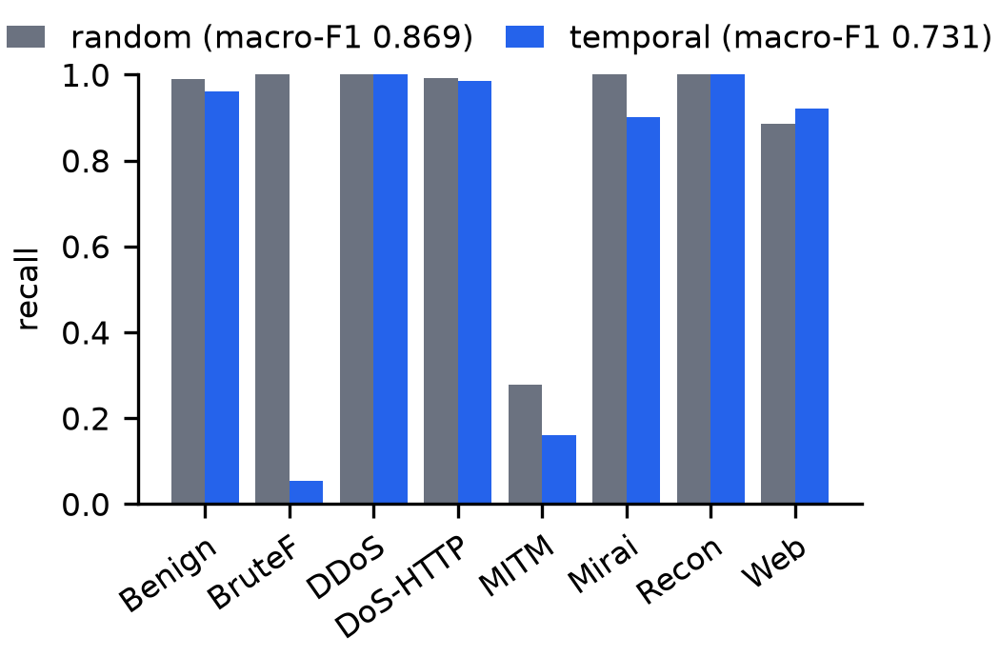
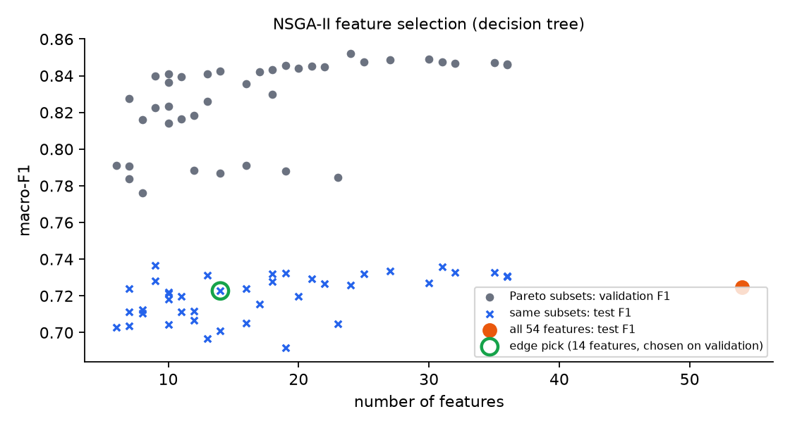
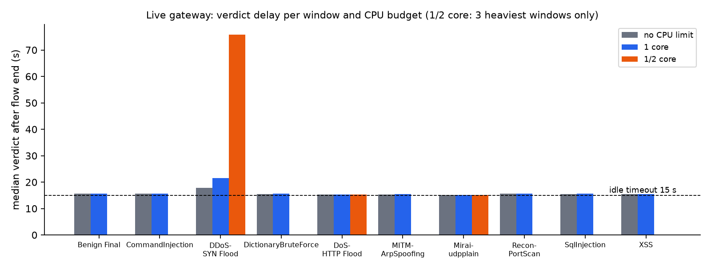

# EdgeFlow-IDS

A lightweight intrusion-detection gateway for IoT networks, built and measured in an emulated
network.

The gateway turns live traffic into network flows (NFStream), classifies every flow with a
small decision tree, and can block an attacking host pair with Open vSwitch drop rules. A
separate ARP watcher covers ARP spoofing, which our flow features did not detect. Everything is
evaluated on labelled CIC-IoT2023 traffic: offline, and live, by replaying held-out traffic
through a Mininet gateway.

**Headline results.**
- On a time-ordered split, decision-tree macro-F1 is 0.731, against 0.869 on a random split (the
  deployed edge tree, tuned on validation, scores 0.725).
- Live macro-F1 matches offline (0.804 vs 0.804, overlapping CIs), with 0 kernel drops at 12k packets/s. Small
  classes make this noisy; see the CIs.
- One CPU core handles a 12–13k packets/s replayed flood without loss, with a backlog of under a
  minute. Half a core falls about a minute behind but loses no flows.
- The ARP watcher catches the MITM attack 1.7 s into its window, with no false high alerts in the
  other windows. This was measured by running the watcher on the same window pcaps; the two live enforcement runs (`enforce_k1`, `enforce_policy`) each raised
  exactly this one high alert.
- A blocking policy chosen on validation data gives 0 false blocks, against 60 for
  block-on-first-alert. The trade-off: it blocks 9 attacker pairs instead of 19, missing the
  7 Mirai bots and the 3 web attackers (CommandInjection, SQLi, XSS).

> **Scope, stated up front.** One dataset (CIC-IoT2023, 10 pcaps, large files trimmed to their
> first 1M packets), 8 classes, one emulated gateway on a laptop (WSL2). "Edge" results come from
> limiting the gateway to one core or half a core with a cgroup quota, not from a physical device.

## What is in this repository

| Part | Files |
|---|---|
| Labelling from evidence: attacker IPs/ports/MACs confirmed from payloads, top talkers and ARP | `data/attackers.json`, `src/extract_flows.py`, `src/diag/` |
| Offline models: decision tree, random forest and gradient boosting; temporal vs random split, 95% bootstrap CIs | `src/train_baseline.py`, `results/baseline_*` |
| Edge model: tree limits tuned on validation, NSGA-II feature selection, saved models, live windows | `src/tune_edge_tree.py`, `src/nsga_select.py`, `src/train_edge_model.py`, `src/make_live_windows.py`, `results/nsga/` |
| Blocking policy chosen on validation | `src/tune_block_policy.py`, `results/block_policy.md` |
| Live gateway: NFStream capture, micro-batched inference, OVS blocking | `src/gateway.py` |
| ARP-spoofing watcher | `src/arp_watch.py` |
| Live experiment: Mininet + OVS + tcpreplay, CPU quota, resource sampling | `topology/`, `src/eval_live.py`, `src/eval_enforce.py` |
| NFStream 6.6.0 fix: idle flows stuck behind a long-lived flow | `src/patch_nfstream.py` |

## Findings

1. **Attack pcaps are mostly not attacks.** In the CIC-IoT2023 web and brute-force pcaps, the
   large majority of flows are background IoT traffic (per-pcap shares in
   [`results/label_shares.md`](results/label_shares.md)). Labelling by file name would be badly
   wrong.
   Every attack class was therefore labelled from evidence, recorded in `data/attackers.json`:
   - HTTP payloads such as `SLEEP(5)`, `UNION SELECT` and `<script>`
   - top talkers and victim ports
   - for ARP spoofing, a MAC that claims the router's IP

2. **Error analysis found a label bug, not a model bug.** 65k "benign" flows that the model kept
   calling DDoS came from a sixth DDoS attacker (`.36`). It joins after the first 300k packets,
   and the early check had missed it. All flood victims were then re-checked over the whole
   trimmed file.

3. **A random split overstates performance.**

   | Split | Decision tree macro-F1 [95% CI] | Benign false-positive rate |
   |---|---|---|
   | Stratified random 70/30 | 0.869 [0.861, 0.875] | 1.1% |
   | Temporal 70/30 per pcap | 0.731 [0.712, 0.742] | 3.9% |

   Most of the drop comes from brute force. Training saw SSH brute force on port 22, but the
   later test period is RTSP brute force on cameras (port 554), an attack variant the model never
   saw. Recall falls to 0.05, while a random split hides this (recall 1.00).

   

4. **A small tree is enough.**
   - On the temporal split, the decision tree (222 KB) is within the confidence interval of a
     random forest: 0.731 vs 0.737.
   - The forest is about 94 times larger (21.3 MB vs 227 KB).
   - The forest is about 58 times slower per single-flow call: 7.8 ms vs 0.14 ms.

5. **NSGA-II reduces the inputs, not the model size.** The edge subset was chosen on validation data only.
   - It uses 14 of the 54 flow statistics.
   - Test macro-F1 is unchanged: 0.723 [0.703, 0.734] vs 0.725 [0.702, 0.741].
   - Model size barely changes: 211 vs 222 KB.
   - Reducing tree size on purpose (depth/leaf limits) raised validation false alarms from 1.3%
     to up to 5.7% (`results/edge_tree_tuning.md`), so the edge tree is kept almost unlimited
     (depth 32).

   

6. **Our NFStream flow features did not detect ARP spoofing.** Traffic relayed by a man in the
   middle looks like normal traffic, and the MITM-ARP class gets precision 0.01 and recall 0.16.
   Other work reports some success with different flow features. The ARP watcher
   flags the attacker instead: a MAC that takes over the router's IP.

7. **NFStream 6.6.0 delays idle-flow export behind long-lived flows.**
   - **The bug:** its LRU flow cache does not move a flow to the most-recent end when a packet
     updates it. A long-running connection therefore stays at the head of the cache, and the
     idle scan stops on it.
   - **The effect:** every idle flow behind it waits for that connection's 120 s active timeout.
   - **The fix:** a one-line patch (`src/patch_nfstream.py`). Flow features are unchanged; only
     the export time is affected.
   - **Measured before/after** on the same two live windows, idle timeout 15 s
     ([`results/nfstream_bug_check.md`](results/nfstream_bug_check.md)):
     - **Original code:** the median verdict came 82.5 s (SQLi) and 49.2 s (XSS) after a flow
       ended. In the XSS window only 65% of the packets were in flows exported before the run
       stopped.
     - **Patched code:** 15.6 s and 15.5 s, with a packet ratio of 1.00 and 0.99.
   - **Status upstream:** reported as
     [nfstream/nfstream#262](https://github.com/nfstream/nfstream/issues/262), with a minimal
     reproduction (`src/diag/nfstream_lru_repro.py`) and the one-line fix. The bug is still in
     NFStream master and is possibly the cause of the older issue #120.

## Live results

Ten unseen 60 s windows (one per pcap, after the train/test boundary) were replayed with
tcpreplay at ×1.0 timing through the Mininet gateway, about 149k flows in total. On this laptop
tcpreplay could not sustain the original rate of the two heaviest windows: DDoS-SYN is about
17,400 packets/s originally, Mirai about 4,800. The loads reported below are the achieved replay
rates, 69–77% of the original. The no-limit and one-core runs used a fixed 30 s gap between
windows. The per-window reset and catch-up wait (see "How the blocking runs are scored") were
added for the half-core and blocking runs. The live model is
`results/models/decision_tree.pkl`: the validation-tuned tree on all 54 features, with test
macro-F1 0.725. Full tables are in
`results/live/<run>/live_vs_offline.md`; the figure shows the verdict delay per window.



**Live matches offline when the pipeline is correct (run `run1`, no CPU limit).**
- Macro-F1: offline 0.804 [95% CI 0.710, 0.845], live 0.804 [0.715, 0.844].
- Packet ratio (live/offline) is 0.99–1.01 in every window, and NFStream reported 0 kernel drops,
  including the DDoS window at 12,271 packets/s.
- Inference costs 0.44 ms per batch (median batch of 209 flows), about 0.004 ms per flow.
- A verdict arrives about 15 s after a flow's last packet (the idle timeout), 17.8 s in the DDoS
  window. The first verdict for an attacker pair comes 15–35 s after its first packet.

**CPU budget** (cgroup quota on the gateway's processes; `edge100` = one core, `edge50` = half a
core on the three heaviest windows):

| DDoS-SYN window (~12–13k packets/s) | No limit | 1 core | 1/2 core |
|---|---|---|---|
| Packet ratio live/offline | 1.00 | 1.00 | 1.00 |
| Median verdict after flow end | 17.8 s | 21.5 s | 75.9 s |
| Extra time after the window to classify its backlog | – | – | 138 s |
| Gateway CPU, mean / max | 120% / 196% | 69% / 104% | 50% / 55% |
| Gateway memory, max RSS | 990 MB | 1,025 MB | 981 MB |
| Attack recall | 1.00 | 1.00 | 1.00 |

With one core, the gateway loses no packets during a 12–13k packets/s replayed SYN flood, and
its median verdict delay rises only from 17.8 s to 21.5 s. A backlog still forms: gateway CPU
stays near 100% for 45–60 s after the replay ends, into the next window. Half a core falls about
a minute behind during the flood. It loses no flows (0 kernel drops, packet ratio 1.00) but needs about 2 more
minutes to classify its backlog. The experiment waits for that before starting the next window,
so the following DoS-HTTP window is unaffected (15.4 s). Memory (about 1 GB at peak, NFStream plus
Python) is the larger obstacle for a real small device.

**ARP spoofing.** These numbers come from `src/eval_arp.py`, which runs the watcher offline on
the same window pcaps, with fresh state per window because each window comes from a different
capture session. In the live blocking runs (`enforce_k1`, `enforce_policy`) the watcher's state is
also reset between windows, and each run raised exactly one high alert, for the same attacker MAC.
- The router-IP rule raised one high alert in the MITM window, 1.7 s into it, naming the
  attacker's MAC.
- It raised no high alert in the other nine windows.
- Without per-window state, IP changes across capture days produced dozens of false "info"
  alerts. The rules for "one MAC with several IPs" and "IP moved to a new MAC" are noisy and are
  only logged, never acted on.

**Blocking:**

| Policy | Host pairs blocked | Correct | False blocks | Packets dropped |
|---|---|---|---|---|
| Block on the first attack verdict (`enforce_k1`) | 79 | 19 | 60 | 326,268 |
| 10 verdicts per pair, MITM-ARP flow verdicts ignored (`enforce_policy`, chosen on validation by `src/tune_block_policy.py`) | 9 | 9 | 0 | 163,546 |

**How the blocking runs are scored.** Blocks, verdict counts and ARP state are cleared after
every window, because each window comes from a different capture session that reuses the same IP
addresses. Each window waits until the gateway has caught up. Dropped packets are counted from
that window's own OVS rule counters.

- **What the validation-chosen policy blocks:** all six DDoS attackers (133k packets dropped),
  the DoS-HTTP attacker (30k), the brute-force attacker, and the port scanner (the scan had already
  ended, so 0 packets were dropped).
- **What it no longer blocks: the 7 Mirai bots and the 3 web attackers (CommandInjection, SQLi,
  XSS).** Each Mirai bot's UDP flood forms only a few long flows, and web attacks produce few flows
  per pair, so no such pair reaches 10 verdicts. Block-on-first-verdict stopped them (Mirai: 100k
  packets) but also blocked 60 innocent pairs.
- **What would fix it:** a packet-rate trigger or early classification, both future work.

## What is and is not new

Not new, and not claimed as new:
- ML intrusion detection for IoT
- live NFStream-based IDS prototypes
- Mininet/OVS blocking
- decision trees and NSGA-II feature selection for edge IDS
- temporal splits scoring lower than random splits
- ARP-spoofing rules (arpwatch does the same)

Several related things were reported before:
- Mixing of benign traffic into attack captures: qualitatively for CIC-IoT2023 (Ramkumar et al.
  2024, arXiv 2412.10738), and for the related CIC IoT-DIAD 2024 dataset (Fadel 2026).
- Evidence-based relabelling, which is established for CIC-IDS2017/2018 (Engelen et al. 2021;
  Liu et al. 2022).
- Replay-based testing of live NIDS.

Our contribution is the measurements and their causes, not new methods. To our knowledge, they
are not reported elsewhere. Sources and caveats are in [`docs/RELATED_WORK.md`](docs/RELATED_WORK.md).
- **Labels:** we measure how much of each CIC-IoT2023 attack capture is background traffic: 91–98%
  of flows in the web, brute-force and MITM captures
  ([`results/label_shares.md`](results/label_shares.md)). Each flow is then labelled from evidence
  (attacker addresses, ports, MACs, HTTP payloads, ARP). Some recent work still labels these pcaps
  by file name (Vitorino et al., FPS 2025, arXiv 2511.08345).
- **Temporal split on CIC-IoT2023:** time-ordered evaluation on CIC-IoT2023 has been used before
  (the per-class "Time-shift" benchmark of Traffic-MoE, arXiv 2601.00357, on session byte
  features). Our split is time-ordered within each capture, on the evidence-relabelled flows. It
  drops macro-F1 from 0.869 to 0.731, and we trace the drop to the brute-force target changing
  from SSH to RTSP. IoTGeM (arXiv 2401.01343) likewise found that brute-force variants
  (telnet vs RTSP) do not generalise to each other, by design rather than through a time split.
- **Offline vs live:** we replay the same held-out windows through a live gateway and get the same
  macro-F1, with full packet accounting and CPU limits. This holds for this one setup and these
  rates, not for live NIDS in general. In contrast, a recent paper saw benchmark performance
  collapse in deployment (Tang et al., VNICT 2026, arXiv 2609.24393).
- **Blocking:** we measure false blocks for block-on-first-alert, and the miss cost of a
  validation-chosen k-verdict policy. k-of-n gating itself is a known idea.
- **NFStream:** we diagnose and patch a (to our knowledge) previously undiagnosed flow-cache ordering defect in
  NFStream 6.6.0 that delays idle-flow export (median 82.5 s vs 15.6 s). The bug is still present
  on master. The symptom was reported before without a root cause (nfstream issue #120; see also
  #193). Reported upstream as [nfstream#262](https://github.com/nfstream/nfstream/issues/262).

## Method

- **Flows.**
  - NFStream 6.6.0 with `statistical_analysis=True`, idle timeout 15 s and active timeout 120 s.
  - The same settings are used offline and live.
  - Identifiers are never model inputs (IPs, MACs, ports, protocol, timestamps), so the model sees
    54 purely statistical features.
- **Labels.** A flow gets an attack label only if:
  - one end is a confirmed attacker and the other a victim, on the attack's port where one is
    known, or
  - for ARP spoofing, it was relayed through the attacker's MAC.

  All other flows in an attack pcap are Benign. The evidence for each attacker is in
  `data/attackers.json`.
- **Temporal split.** Inside each pcap, the first 70% of flows by start time are used for
  training. Validation for tuning and NSGA-II is the last 20% of that training period. The test
  split is never used for choices.
- **Live windows.**
  - One 60 s window per pcap, starting just after the train/test boundary.
  - Connections that a training flow was still part of are removed from both the offline and the
    live side.
  - h1 replays each window with tcpreplay at ×1.0 timing (the achieved rate is 69–77% of the
    original for the two heaviest windows). The gateway captures on `gw-eth0`.
  - A 200 packet/s ping keeps NFStream's timers moving between windows. Management traffic is
    never scored or blocked.

## Limitations

- **Small test classes.** Mirai has only 10 test flows and MITM-ARP 25, so their per-class
  numbers and macro-F1 are noisy. Use the CIs and the macro-F1 over classes with at least 50 test
  flows.
- **Connections spanning the train/test boundary.** A long connection is cut into several flows
  (idle 15 s, active 120 s), so 36% of the temporal test flows continue a connection whose earlier
  flows are in training ([`results/split_overlap.md`](results/split_overlap.md)).
  - Removing them barely changes macro-F1 over the classes that keep test flows (0.700 vs 0.690).
  - **All 10 Mirai test flows** are such continuations, so the Mirai test score is not evidence of
    generalisation.
  - The live evaluation already removes these connections from both sides.
- **Within-session generalisation only.** Each attack class comes from one capture session, so
  the temporal split tests generalisation within that session.
- **Trimmed pcaps.** Large pcaps are trimmed to 1M packets, so DDoS-SYN dominates the flow count.
- **Slow verdicts.** A verdict needs the flow to end (idle timeout 15 s), so this is not per-packet
  real-time detection. Early classification after N packets is future work.
- **Coarse blocking.** Blocking acts on whole host pairs. With the validation-chosen policy (10
  verdicts), floods that form few long flows, such as Mirai's UDP flood, and low-volume web attacks are not
  blocked.
- **Memory.** The gateway needs about 1 GB at peak, which is too much for the smallest edge
  devices.
- **One run per setting.** Each live setting was run once, so the timing figures carry run-to-run
  noise.
- **One dataset.** A cross-dataset test (for example IoT-23) is future work.

## Reproduce

Tested on Windows 11, WSL2 Ubuntu 24.04 (kernel 6.6), Python 3.12, CPU only. The CPU-quota runs use
`systemd-run`, so WSL needs `systemd=true` in `/etc/wsl.conf`.

```bash
# 1. system packages + venv (/opt/edgeflow) + NFStream patch
sudo apt install -y mininet openvswitch-switch openvswitch-testcontroller tcpreplay tshark tcpdump iptables ethtool python3-venv
sudo bash src/setup_venv.sh            # pip install -r requirements.txt + patch_nfstream.py
# 2. data: CIC-IoT2023 pcap subset (~5 GB), resumable
bash src/download_data.sh all
# 3. offline: trim, extract + label flows
sudo bash src/run_all.sh
# 4. tune the edge tree, baselines on both splits, NSGA-II, edge models, live windows
sudo bash src/run_offline2.sh
# 5. live runs (Mininet): detection, 1 core, half a core, block-on-first-verdict (enforce_k1)
sudo bash src/run_live3.sh
# 6. blocking policy chosen on validation + live run with it; NFStream bug before/after
sudo bash src/run_enforce2.sh
sudo bash src/run_bug_check.sh
# 7. label shares, ARP watcher per window, figures
sudo /opt/edgeflow/bin/python src/label_shares.py
sudo /opt/edgeflow/bin/python src/diag/check_split_overlap.py
sudo /opt/edgeflow/bin/python src/eval_arp.py
sudo /opt/edgeflow/bin/python src/make_figures.py
```

`results/models/` is not committed (pickles); step 4 rebuilds it. The committed `enforce_k1`,
`enforce_policy` and `edge50` results come from `src/run_final_live.sh`, which runs the same
commands as steps 5–6 with the final per-window reset and catch-up wait. Diagnostic scripts used to
confirm attackers and find bugs are in `src/diag/`.

## License

Code is released under the [MIT License](LICENSE). The CIC-IoT2023 data is not part of this
repository and is subject to its own terms.

## Data and credit

- **Dataset:** E. C. P. Neto et al., "CICIoT2023: A real-time dataset and benchmark for
  large-scale attacks in IoT environment", *Sensors* 23(13), 5941, 2023, doi:10.3390/s23135941. Raw pcaps are not
  redistributed here.
- **Software:** NFStream (Aouini and Pekar), Mininet, Open vSwitch, scikit-learn and pymoo.
- **Related work:** see [`docs/RELATED_WORK.md`](docs/RELATED_WORK.md) for sources and how
  closely each was checked.
  - Ramkumar et al., arXiv 2412.10738.
  - Vitorino et al., arXiv 2511.08345.
  - Tang et al., arXiv 2609.24393.
  - Arp et al., USENIX Security 2022.
  - Engelen et al. 2021 and Liu et al. 2022, on labelling errors in CIC-IDS2017/2018.
  - Fadel 2026, on folder labels and splits in CIC IoT-DIAD 2024.
